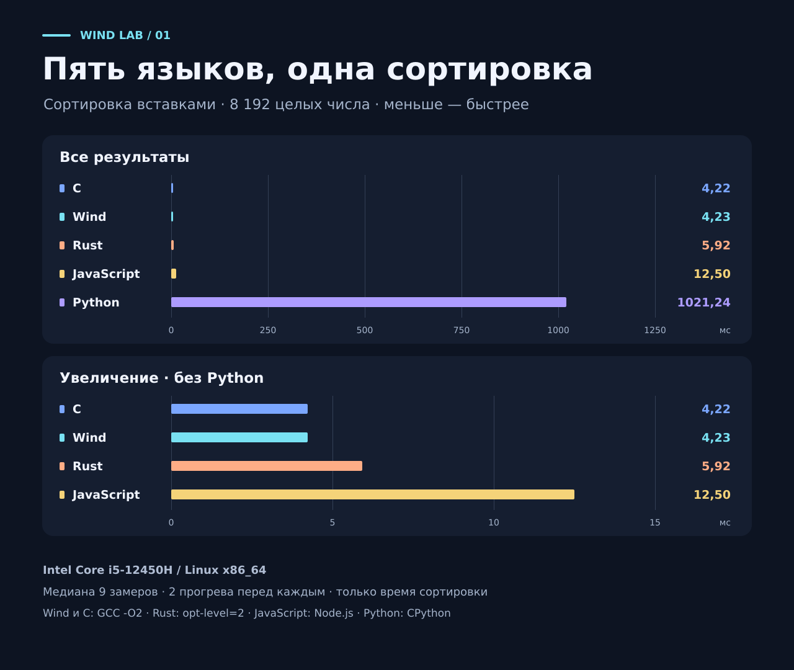

# Wind Lab 01 — сортировка вставками

Один алгоритм на [Wind](sort.wnd), [C](sort.c), [Rust](sort.rs),
[Python](sort.py) и [JavaScript](sort.mjs). Результаты: [график PNG](results.png)
и [все замеры в JSON](results.json).



## Что измеряли

- Сортировка 8 192 целых чисел. Все программы генерируют один и тот же набор
  с фиксированным seed и сортируют его вручную, без библиотечной сортировки.
- На каждом замере процесс дважды прогоняет алгоритм для прогрева. Третий
  проход замеряется монотонными часами. Запуск процесса, генерация данных,
  прогрев, контрольная сумма и вывод не входят в измерение.
- Девять раундов. В каждом языки запускаются по одному, в перемешанном порядке.
  На графике — медианы. Скрипт сверяет контрольную сумму каждого результата
  с эталонной, посчитанной по независимо отсортированному набору.
- Wind генерирует C и использует тот же GCC с `-O2`, что и ручная версия C.
  Rust собран с `-C opt-level=2`. Wind, C и Rust используют массивы целых,
  Node.js — `Int32Array`, CPython — обычный список.

Это сравнение конкретных реализаций на одной машине, а не рейтинг языков.
Нижняя панель повторяет четыре результата в увеличенном масштабе; обе шкалы
начинаются с нуля.

## Как повторить

На Linux понадобятся GCC, заголовки и библиотека Boehm GC, Rust, CPython,
Node.js и ImageMagick с поддержкой SVG и шрифтом DejaVu Sans.

```sh
python3 benchmarks/sort/run.py --out /tmp/wind-sort-results
```

Можно указать путь к Node.js через `--node`. Если не передать `--out`, скрипт
перезапишет `results.png` и `results.json` рядом с исходниками.
